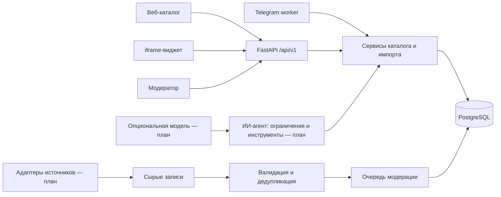

# Архитектура

## Решение

Модульный монолит: Python/FastAPI, SQLAlchemy 2, Alembic, PostgreSQL; React + TypeScript + Vite; Telegram-worker на aiogram. В Docker веб-сборка раздаётся тем же приложением, поэтому браузеру не нужны сторонние cookies или доступ к отдельному домену API. Для локальной разработки и изолированных тестов предусмотрен SQLite с теми же моделями и миграциями. PostgreSQL — целевой контур.

## Границы модулей

- `models`, `schemas`: постоянное хранение и публичные контракты. Поля, неизвестные источнику, nullable. Время события хранится с часовым поясом; Башкортостан — UTC+5 (`Asia/Yekaterinburg`).
- `catalog`: только опубликованные события в выдаче; отменённые доступны по UUID с явным статусом; черновики недоступны публично.
- `ingestion`: валидация отдельной строки, SHA-256 сырой записи, устойчивый ключ название/начало/площадка, объединение источников, отчёт добавлено/обновлено/пропущено/отклонено. Сырые записи хранятся отдельно.
- `moderation`: отдельная авторизация, атомарные изменения и журнал до/после. Ни модель, ни сборщик не получают административные полномочия.
- `query_parser` и `bot_controller`: текущий детерминированный разбор и Telegram-сценарии. Worker вызывает общие сервисы напрямую и не зависит от HTTP-запросов к веб-серверу. `assistant` — планируемый модуль: будущий LLM-провайдер извлекает структурированные ограничения и выбирает только ID из результатов инструментов. Факты и объяснения собирает код; произвольный текст модели не становится фактом.
- `subscriptions`, `feedback`: только необходимые данные, ограничение частоты, явное подтверждение изменения. Удаление подписки удаляет фильтр и идентификатор.

## Данные и доверие

`raw_records` → нормализация → `events`; список источников хранится в JSON-поле `events.sources`. Отдельной таблицы `event_sources` в текущей схеме нет. `audit_entries` фиксируют автора, время и изменение. Источники и пользовательские сообщения — данные, не инструкции. URL принимаются только HTTP(S); сборщик будущего этапа использует разрешённые домены и блокирует внутренние адреса/редиректы к ним. События с противоречащими полями не публикуются автоматически.

Поле «проверено» означает проверку конкретной ссылки и извлечённых полей в указанное время, а не гарантию отсутствия последующей отмены. Стоимость «от» — нижняя граница, не обещание наличия билетов. При неизвестной цене фильтр бюджета исключает событие. При неизвестном конце нельзя обещать завершение до указанного часа. Нельзя объявлять официальным сервисом без согласования.

## Безопасность и наблюдаемость

Админка закрыта случайным секретом из окружения; без секрета мутации недоступны. Публичные списки полей заданы схемами. Запросы SQL параметризованы. HTML источника не выводится как HTML. Логи содержат метод, шаблон маршрута, код, задержку и случайный request ID; не текст сообщений, IP, cookies, токены или UUID пользователей. Трассы агента в дальнейшем хранятся отдельно с редактированием чувствительного текста и ограниченным сроком.

Порог метрик задаёт ТЗ, а не архитектурное обещание. Rate limit первой версии рассчитан на один процесс; горизонтальное масштабирование потребует общего хранилища лимитов. Redis и векторный поиск добавляются только при измеренной необходимости. Для поиска похожих по категории/меткам отдельная векторная база не требуется.

## Отложенные решения

Провайдер/стоимость LLM, словарь башкирского языка, права на фотографии и официальный брендинг, регламент модерации и хранения согласуются отдельно. Базовый поиск продолжает работать независимо от этих решений. Производственный TLS, резервные копии, ротация ключей и мониторинг проверяются на целевом хосте перед публичным запуском.
