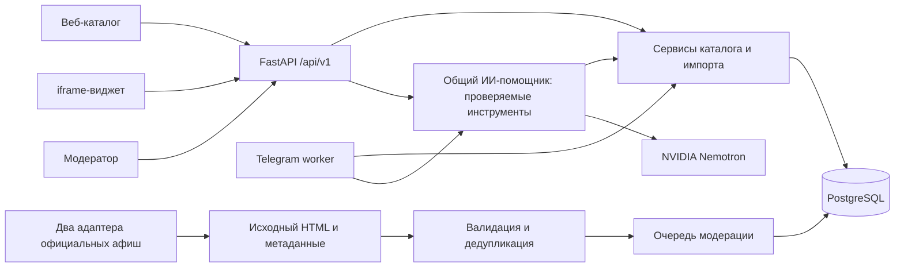

# Архитектура

## Решение

Модульный монолит: Python/FastAPI, SQLAlchemy 2, Alembic, PostgreSQL; React + TypeScript + Vite; Telegram-worker на aiogram. В Docker веб-сборка раздаётся тем же приложением, поэтому браузеру не нужны сторонние cookies или доступ к отдельному домену API. Для локальной разработки и изолированных тестов предусмотрен SQLite с теми же моделями и миграциями. PostgreSQL — целевой контур.

## Границы модулей

- `models`, `schemas`: постоянное хранение и публичные контракты. Поля, неизвестные источнику, nullable. Время события хранится с часовым поясом; Башкортостан — UTC+5 (`Asia/Yekaterinburg`).
- `catalog`: только опубликованные события в выдаче; отменённые доступны по UUID с явным статусом; черновики недоступны публично.
- `ingestion`: валидация отдельной строки, SHA-256 сырой записи, устойчивый ключ название/начало/площадка, объединение источников, отчёт добавлено/обновлено/пропущено/отклонено. Сырые записи хранятся отдельно.
- `moderation`: отдельная авторизация, проверка версии и журнал до/после. Модель не получает административных действий. Сборщик создаёт черновики и предложения; явная отмена снимает событие с выдачи, другие проверенные поля меняет модератор.
- `collection`, `source_adapters`, `collection_api`: два адаптера, сохранение исходных страниц, связь источника с UUID события, расписание и кабинет сверки. Общий валидатор импорта используется для новых черновиков. [Устройство и ограничения сбора](COLLECTION.md).
- `query_parser` и `bot_controller`: разбор правилами и Telegram-сценарии. Worker вызывает сервисы напрямую, без HTTP к веб-серверу. `assistant` — общий движок сайта и бота; `llm` — ограниченный провайдер NVIDIA, `assistant_schemas` — строгие аргументы, `assistant_api` — приватные маршруты. Модель выбирает действие; ID, ограничения и подтверждения проверяет сервер, факты и объяснения собирает код. [Подробности](ASSISTANT.md).
- `subscriptions`, `feedback`: только необходимые данные, ограничение частоты, явное подтверждение изменения. Удаление подписки удаляет фильтр и идентификатор.

## Данные и доверие

`source_pages` хранит сжатый исходный HTML; `collected_items` — извлечённые сведения и связь с событием; `collection_runs` — результаты запусков. Далее общий импорт использует `raw_records` → `events`; происхождение события также хранится в `events.sources`. Отдельной таблицы `event_sources` нет. `audit_entries` фиксирует изменения. Источники и запросы — данные, не инструкции. Сборщик загружает только настроенные HTTPS-домены и пути, проверяет публичные DNS-адреса и каждый редирект. Спорные поля не публикуются автоматически.

Поле «проверено» означает проверку конкретной ссылки и извлечённых полей в указанное время, а не гарантию отсутствия последующей отмены. Стоимость «от» — нижняя граница, не обещание наличия билетов. При неизвестной цене фильтр бюджета исключает событие. При неизвестном конце нельзя обещать завершение до указанного часа. Нельзя объявлять официальным сервисом без согласования.

## Безопасность и наблюдаемость

Админка закрыта секретом из окружения; без секрета мутации недоступны. Публичные поля заданы схемами, SQL параметризован, HTML источника не исполняется. Логи содержат метод, шаблон маршрута, код, задержку и случайный request ID, без текста сообщений, IP, cookies, токенов и UUID пользователей. Трассы агента хранятся отдельно до семи дней, доступны только модератору и маскируют распространённые секреты и контакты. Память ограничена шестью парами реплик и 24 часами; запрос и история передаются NVIDIA с уведомлением в интерфейсе.

Порог метрик задаёт ТЗ, а не архитектурное обещание. Rate limit первой версии рассчитан на один процесс; горизонтальное масштабирование потребует общего хранилища лимитов. Redis и векторный поиск добавляются только при измеренной необходимости. Для поиска похожих по категории/меткам отдельная векторная база не требуется.

## Отложенные решения

NVIDIA и бесплатный прототипный доступ выбраны пользователем; стоимость учитывается по правилам ASSISTANT.md. Словарь башкирского языка, права на фотографии, официальный брендинг и производственный регламент согласуются отдельно. Базовый поиск работает при недоступной модели. TLS, восстановление резервной копии и мониторинг проверяются на целевом хосте.
